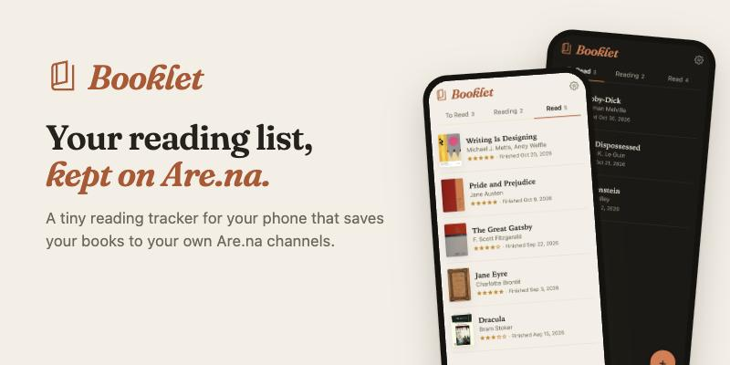
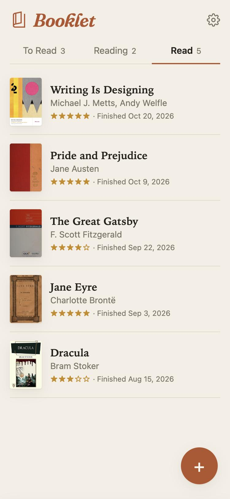
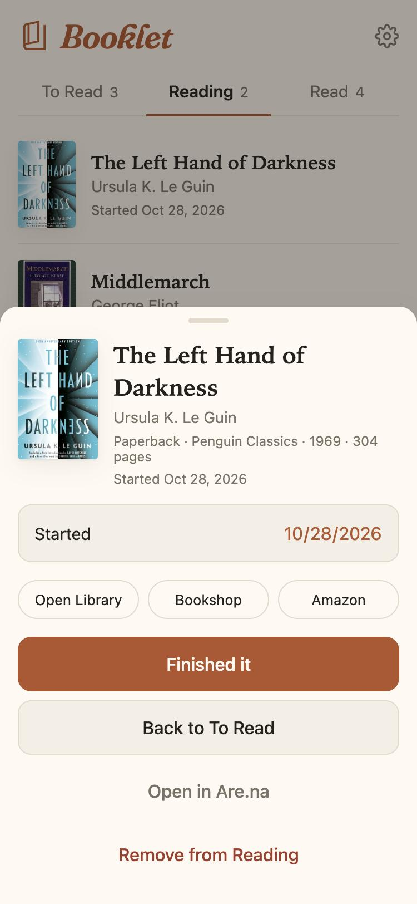
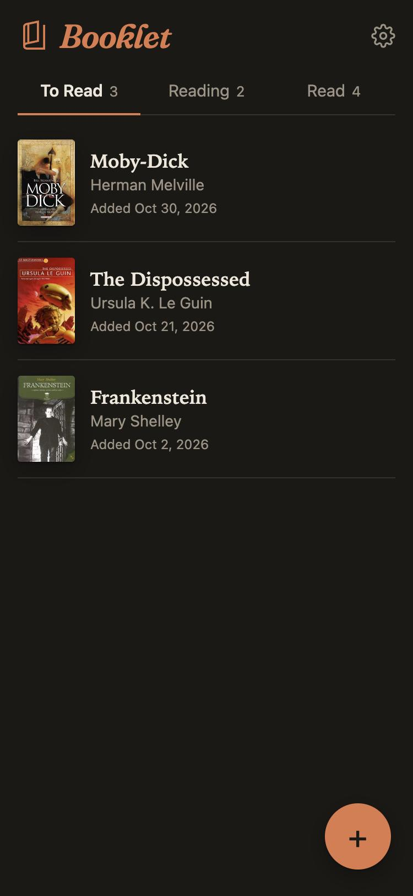

<p align="center">
  <a href="https://booklet.lol">
    <picture>
      <source media="(prefers-color-scheme: dark)" srcset="site/banner-dark.jpg">
      
    </picture>
  </a>
</p>

<p align="center">
  <a href="https://booklet.lol"><strong>booklet.lol</strong></a> ·
  <a href="#set-up-your-own-copy">Set up your own copy</a> ·
  <a href="#how-it-works">How it works</a>
</p>

**Booklet** is a tiny reading tracker for your phone. It has three shelves — To Read, Reading and Read —
and every book you add gets saved to channels in your own [Are.na](https://www.are.na) account.

Here's what it does:

- Searches Open Library and Google Books at the same time, so it finds new releases and doesn't mind typos.
- Saves the U.S. print edition (hardcover, if there is one) with its cover, publisher, page count, ISBN and
  links to Bookshop, Amazon and Open Library.
- Writes down when you start and finish a book, lets you give it stars, and lets you fix the dates later.
- Opens from your phone's home screen like any other app, in light or dark mode.
- Runs entirely in your browser. There's no Booklet server, and your Are.na token stays on your device.

I made it because I wanted a quick reading list that wasn't a social network. It's free and open source.

<p align="center">
  
  &nbsp;
  
  &nbsp;
  
</p>

> Booklet is an independent project. It isn't made by or affiliated with Are.na.

## How it works

Each shelf is an Are.na channel you own. Booklet makes them as *closed* channels, which means anyone can
look at them but only you can add to them.

Each book is a block: an image of the cover, with the book's details saved as metadata on the block.
Moving a book to another shelf moves its connection, and the dates and your rating are stored on that
connection.

Search uses Open Library and Google Books together. In testing, Google was better at finding books
(especially new releases and misspellings) and Open Library was better at telling editions apart. Booklet
merges the results and saves the U.S. English print edition, hardcover first, based on the ISBN and
publisher.

Your token is saved in your browser's local storage and only ever gets sent to Are.na.

### Do I need Are.na Premium?

Nope. Booklet doesn't use any Premium-only API features. Free accounts get lower API rate limits
(30 changes a minute instead of 60), but a reading list doesn't come anywhere near that.

## Set up your own copy

1. **Deploy it.** Fork this repo and deploy it to any static host. On Netlify:
   [](https://app.netlify.com/start/deploy?repository=https://github.com/awelfle/booklet)
   There's no build step: the publish directory is the repo root.
2. **Make an Are.na token** at [are.na/settings/personal-access-tokens](https://www.are.na/settings/personal-access-tokens)
   with **write** scope.
3. **Open your copy**, tap **Set up Booklet**, paste the token and tap **Create my shelves on Are.na**.
   (Already have channels you want to use? Paste their links instead and tap Save.)
4. **On iPhone:** Share → Add to Home Screen.

One iPhone quirk: an app on your home screen doesn't share storage with Safari, so you'll need to paste
your token in again there. If you don't want to re-enter your shelves on every new device, put their
slugs in `DEFAULT_CHANNELS` (more on that below).

### Optional: a Google Books key

You don't need one. Without it, Booklet only searches Open Library, which is a little slower to list
brand-new books.

1. In [Google Cloud Console](https://console.cloud.google.com), create a project and enable the **Books API**.
2. Create an **API key**. Restrict it to **Websites** → your copy's address (e.g. `https://books.example.com/*`)
   and to the **Books API**. It's safe in client code once restricted.
3. Put it in `GOOGLE_BOOKS_KEY` (below). Google's default quota is 1,000 searches a day.

### Settings: `js/config.js` and `config.local.js`

`js/config.js` holds the optional settings: `GOOGLE_BOOKS_KEY` and `DEFAULT_CHANNELS`. To keep your
values out of a public fork, copy `js/config.js` to `config.local.js` at the repo root (it's gitignored),
fill it in, and deploy with `scripts/deploy.sh`, which swaps it in. Or just edit `js/config.js` in a
private fork.

## Development

It's plain HTML, CSS and JavaScript modules, with no framework and no build step.

| Path | |
|---|---|
| `index.html`, `styles.css` | Markup and styles |
| `js/config.js` | Optional settings |
| `js/app.js` | UI: shelves, add-a-book search, book sheet, settings |
| `js/arena.js` | Are.na client and shelf rules |
| `js/search.js` | Google Books + Open Library search, merged per book |
| `js/editions.js` | Picks the edition to save and builds the stored record |
| `js/util.js` | Small shared helpers |
| `tests/` | Unit tests (`npm test`, Node 20+), with real Open Library edition lists as fixtures |
| `scripts/check-search.js` | Runs ~26 real searches through the app's code and prints what would be saved |
| `scripts/import-books.mjs` | Bulk-adds prepared books to a shelf |
| `scripts/deploy.sh` | Deploys a clean export to the linked Netlify site |
| `site/` | The booklet.lol landing page and README images (`banner.html` is the banner's source) |

```sh
python3 -m http.server 8000   # then open http://localhost:8000
npm test
node scripts/check-search.js  # after changing search.js or editions.js
```

## Credits

- Book data from [Open Library](https://openlibrary.org) and [Google Books](https://books.google.com).
- Book icon: [Material Symbols](https://fonts.google.com/icons) `book_5` (Apache 2.0).
- Wordmark: [Fraunces](https://fonts.google.com/specimen/Fraunces) (SIL Open Font License).

## License

MIT
